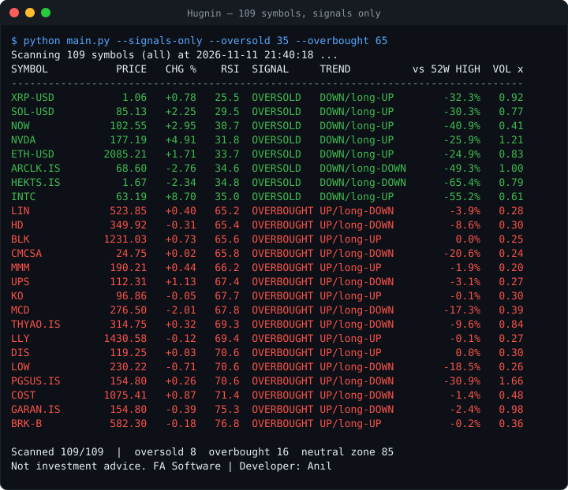
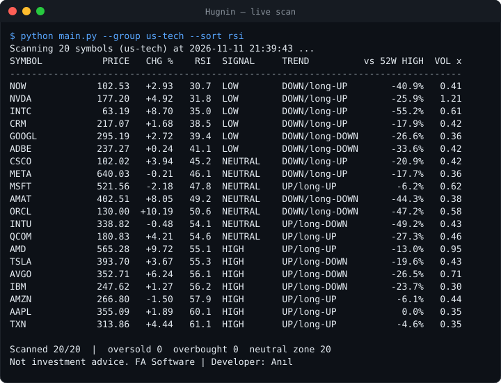
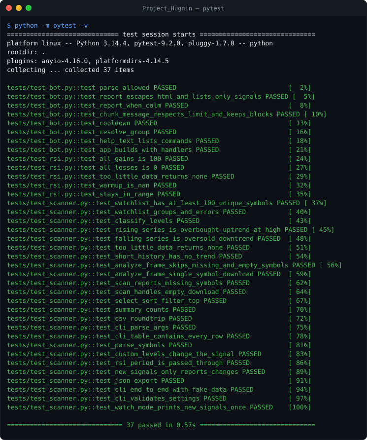
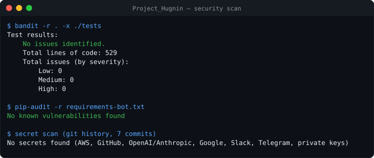

# Hugnin | RSI Market Scanner

> *"Data is merely noise until logic gives it a voice."*

[](https://github.com/fas0ftware/Project_Hugnin/actions/workflows/ci.yml)


A terminal scanner and a private Telegram bot that check **109 stocks and cryptos** (or any symbols you give it) in one batched request and flag **oversold** and **overbought** conditions with the Relative Strength Index.

For an interactive dashboard with charts, see the companion project [Project_Heimdall](https://github.com/fas0ftware/Project_Heimdall).



## ◼ Features

**Scanner (`main.py`)**
- **109 symbols out of the box** in 8 groups (`watchlist.py`): US tech, finance, health, consumer, industrial, energy/utilities, 25 Borsa Istanbul stocks and 5 cryptos – or **your own list** with `--symbols AAPL,THYAO.IS,BTC-USD`.
- **One batched download** for the whole list, so a full scan takes seconds.
- **Per symbol:** price, 1-day change, RSI (Wilder), signal, trend (price vs SMA 50 and the 50/200 cross), distance from the 52-week high, today's volume vs the 20-day average.
- **Tunable RSI:** `--rsi-period`, `--oversold`, `--overbought`.
- **Filters and sorting:** `--signals-only`, `--sort rsi|change|high|symbol`, `--desc`, `--top N`.
- **Export:** `--csv file.csv`, `--json file.json`.
- **Watch mode:** `--watch 300` rescans every 5 minutes and highlights **only new signals** since the previous scan.
- Color output (automatically plain when piped, or with `--no-color` / `NO_COLOR`); missing symbols are skipped and listed.

**Telegram bot (`hugnin_bot.py`)**
- `/scan [group]`, `/groups`, `/subscribe [minutes]`, `/unsubscribe`, `/help` (`/analiz` still works as an alias).
- **Scheduled alerts** that fire only when a *new* signal appears, so you are not spammed with the same symbols.
- **Private by default:** only chat IDs in `ALLOWED_CHAT_IDS` are served; everyone else is refused and logged.
- **Abuse protection:** 60-second cooldown per chat for manual scans; alert interval clamped to 15 min – 24 h.
- **Safe output:** HTML-escaped messages, automatically split under Telegram's 4096-character limit.
- The bot token is never written to logs (the HTTP client's request logging is silenced).

Example alert:

```
🚨 New Hugnin signals
Group all · scanned 109/109

🟢 OVERSOLD | XRP-USD
   └ Price 1.06 (+0.83%) · RSI 25.6 · Trend DOWN/long-UP

🔴 OVERBOUGHT | GARAN.IS
   └ Price 154.80 (-0.39%) · RSI 75.3 · Trend UP/long-DOWN

Not investment advice – algorithm output.
```

## ◼ Installation

```bash
git clone https://github.com/fas0ftware/Project_Hugnin.git
cd Project_Hugnin
python3 -m venv venv && source venv/bin/activate   # Windows: venv\Scripts\activate
pip install -r requirements.txt                    # scanner only
pip install -r requirements-bot.txt                # scanner + Telegram bot
```

## ◼ Usage

```bash
python main.py                                     # all 109 symbols once, sorted by RSI
python main.py --group bist --top 10               # ten lowest-RSI Borsa Istanbul stocks
python main.py --symbols "AAPL, NVDA, BTC-USD"     # your own list
python main.py --signals-only --oversold 35 --overbought 65
python main.py --group us-tech --csv tech.csv --json tech.json
python main.py --watch 300                         # rescan every 5 minutes, flag new signals
python main.py --list-groups
```



### Telegram bot

1. Create a bot with [@BotFather](https://t.me/BotFather) and copy `.env.example` to `.env`.
2. Put the token in `TELEGRAM_TOKEN`, start the bot with `python hugnin_bot.py` and send it `/start`.
3. The bot refuses you and logs your chat id – add it to `ALLOWED_CHAT_IDS` and restart.
4. `/scan bist` for a report, `/subscribe 60` for hourly alerts on new signals.

## ◼ Tests

37 tests with generated price series and a fake downloader (no network): RSI edge cases, metrics, signals with custom levels, symbol validation, CSV/JSON export, new-signal detection, the CLI end to end (including watch mode), and the bot's report formatting, HTML escaping, message chunking, cooldown, access list and handler wiring.

```bash
pip install -r requirements-dev.txt
python -m pytest -v
```



## ◼ Security

CI runs [bandit](https://github.com/PyCQA/bandit) and [pip-audit](https://github.com/pypa/pip-audit) on every push. Latest local scan, including a secret scan of the full git history:



## ◼ Project structure

```
Project_Hugnin/
├── main.py              # Terminal scanner (CLI)
├── hugnin_bot.py        # Telegram bot
├── scanner.py           # Batch download, metrics, signals, sorting, CSV/JSON, new-signal diff
├── watchlist.py         # The 109 symbols in groups
├── rsi.py               # Shared RSI calculation
├── tests/               # test_rsi.py, test_scanner.py, test_bot.py
├── requirements.txt     # Scanner
├── requirements-bot.txt # Scanner + bot
└── .env.example         # Token, allowed chats, default group
```

## ◼ Notes and limitations

- `yfinance` is an unofficial Yahoo Finance client; data can be delayed, incomplete or unavailable.
- RSI alone is not a buy or sell signal.
- Tickers change (mergers, delistings, renamed Borsa Istanbul codes – e.g. KOZAL.IS became TRALT.IS). Symbols without data are skipped and reported.
- Bot alert subscriptions live in memory and are cleared when the bot restarts.

## ◼ Changelog

- **3.0.0** – Custom symbol lists, tunable RSI period/levels, JSON export, new-signal highlighting in watch mode, `--no-color`; bot rewritten in English with access control, cooldown, scheduled new-signal alerts, HTML escaping, message chunking and token-safe logging; KOZAL.IS → TRALT.IS; pytest suite; CI security scans.
- **2.0.0** – 109-symbol watchlist, batched scan engine, trend / 52-week / volume columns, filters, CSV, watch mode.
- **1.0.0** – RSI scan of a short list, Telegram report.

## ◼ Disclaimer

This software is for educational and informational purposes only. It does not constitute financial advice.

---

Part of the **FA Software** projects. Licensed under the [MIT License](LICENSE).
