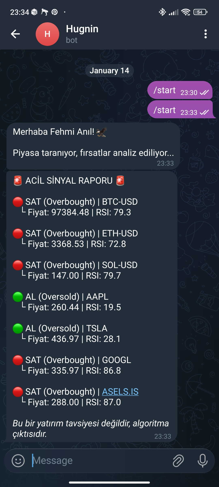

# Hugnin | RSI Market Scanner

> *"Data is merely noise until logic gives it a voice."*

A terminal scanner and Telegram bot that check major assets and flag overbought and oversold conditions using the 14-day Relative Strength Index (RSI).

## ◼ Overview

**Hugnin** analyzes market data and applies a technical indicator, RSI, to spot assets that may be overbought or oversold. It comes in two forms that share the same RSI code (`rsi.py`):

- **Terminal scanner** (`main.py`): a quick, color-coded check from the command line. This is the public demo version.
- **Telegram bot** (`hugnin_bot.py`): sends a signal report to your chat on `/start` or `/scan`.

For a visual, interactive version with charts, see the companion project [Project_Heimdall](https://github.com/fas0ftware/Project_Heimdall).

## ◼ Preview

Telegram bot report:



## ◼ Features

- **109 symbols out of the box** in 8 groups (`watchlist.py`): US tech, finance, health, consumer, industrial and energy/utilities blue chips (85), 25 Borsa Istanbul stocks and 5 major cryptos. Pick one with `--group`.
- **One batched download** for the whole list (not one request per symbol), so a full scan takes seconds.
- **Per-symbol metrics:** price, 1-day change, 14-day RSI (Wilder's smoothing, same as Project_Heimdall), signal, trend (price vs 50-day average and 50/200-day cross), distance from the 52-week high and today's volume vs the 20-day average.
- **Filters and sorting:** `--signals-only`, `--sort rsi|change|high|symbol`, `--desc`, `--top N`.
- **CSV export:** `--csv result.csv`.
- **Watch mode:** `--watch 300` repeats the scan every 5 minutes.
- **Color-coded terminal output:** oversold (RSI < 30) in green, overbought (RSI > 70) in red.
- **Telegram bot:** scans the same watchlist (group chosen with `HUGNIN_GROUP`) and reports only the assets outside the 30 to 70 RSI range, with price, change and trend.
- **Error handling:** symbols with missing or too little data are skipped and listed at the end, so one delisted ticker never stops a scan.

## ◼ Project structure

```
Project_Hugnin/
├── main.py                # Terminal scanner (CLI)
├── hugnin_bot.py          # Telegram bot
├── scanner.py             # Batch download, metrics, signals, sorting, CSV
├── watchlist.py           # The 109 symbols in groups
├── rsi.py                 # Shared RSI calculation
├── tests/
│   ├── test_rsi.py
│   └── test_scanner.py
├── docs/
│   └── telegram_preview.jpeg
├── requirements.txt       # Terminal scanner dependencies
├── requirements-bot.txt   # Scanner + Telegram bot dependencies
└── .env.example           # Template for the bot token and default group
```

## ◼ Requirements

- Python 3.9 or newer
- pip
- An internet connection (market data is fetched online)
- For the bot: a Telegram bot token from [@BotFather](https://t.me/BotFather)

## ◼ Installation

```bash
git clone https://github.com/fas0ftware/Project_Hugnin.git
cd Project_Hugnin
```

Create and activate a virtual environment.

Linux / macOS:

```bash
python3 -m venv venv
source venv/bin/activate
```

Windows:

```bash
python -m venv venv
venv\Scripts\activate
```

Install dependencies for the terminal scanner:

```bash
pip install -r requirements.txt
```

Or, to also run the Telegram bot:

```bash
pip install -r requirements-bot.txt
```

## ◼ Usage

**Terminal scanner**

```bash
python main.py                              # scan all 109 symbols once, sorted by RSI
python main.py --group bist --top 10        # ten lowest-RSI Borsa Istanbul stocks
python main.py --signals-only --desc        # only oversold / overbought, highest RSI first
python main.py --group us-tech --csv tech.csv
python main.py --watch 300                  # rescan every 5 minutes
python main.py --list-groups
```

**Telegram bot**

1. Copy `.env.example` to `.env` and put your own token in it. The `.env` file is ignored by git, so the token stays private.
2. Start the bot:

```bash
python hugnin_bot.py
```

3. Send `/start`, `/scan` or `/analiz` to the bot in Telegram. All three run the same scan.

To track other assets, edit the groups in `watchlist.py` (Yahoo Finance symbols, such as `BTC-USD` or `THYAO.IS`).

**Tests**

```bash
python tests/test_rsi.py
python tests/test_scanner.py
```

The scanner tests use generated price series and a fake downloader, so they need no internet.

## ◼ Notes and limitations

- `yfinance` is an unofficial client for Yahoo Finance. Data can be delayed, incomplete or unavailable at times.
- RSI is a single indicator. An oversold or overbought reading is not a buy or sell signal on its own. The bot's "AL" and "SAT" labels only describe the RSI zone.
- The bot scans only when you message it; it does not send scheduled alerts.
- The list holds established, liquid companies, but tickers change (mergers, delistings, renamed Borsa Istanbul codes). Symbols Yahoo has no data for are skipped and reported. The live download has not been verified in the automated checks (no network there); the scan logic is covered by tests.

## ◼ Disclaimer

This software is for educational and informational purposes only. It does not constitute financial advice.

---

Part of the **FA Software** projects.
